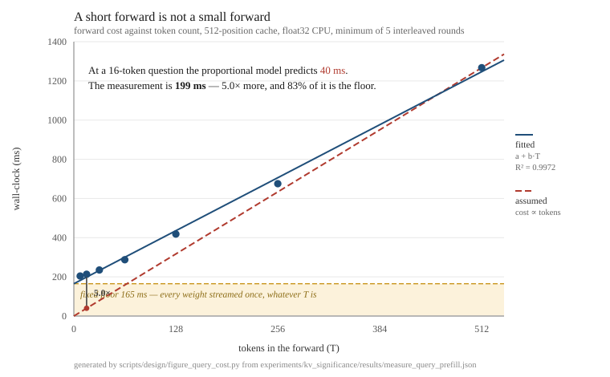

# Evidence lives in spans: the unit of KV-cache eviction, and why its reach must be derived

**Submission draft, revised 2026-08-29** (first draft 2026-08-24). Cornerstone 2 of the
Rineya significance-matrix programme. Companion to `PAPER_DRAFT_SIGNIFICANCE.md`
(cornerstone 1, branch `main`), which introduces the significance matrix itself. This
paper is about how that matrix's scores must be *read*, not about the scores.

> **Status of every number below.** All figures reproduce from committed JSON via
> `scripts/design/verify_claims.py` (**252 pinned claims, 252/252 reproducing**), which
> checks each number both against the data that produced it *and* against the prose that
> quotes it, so a figure cannot drift in one copy only. Structural completeness of the
> result tree is checked separately by `scripts/design/check_results_integrity.py`
> (**0 problems**). Where a claim has been retracted during the work it appears in
> Appendix A rather than being deleted. References in §2 were resolved against primary
> sources on 2026-08-29.

**Reproduction.** Every command needed to re-derive the figures is in Appendix C. The two
verification entry points above run on CPU in seconds and are the correct first step for a
reviewer.

---

## Abstract

KV-cache eviction methods rank cached positions by an importance score and keep the
top-*k*. We show that this per-position framing is the wrong unit, and that fixing the
unit is worth more than improving the score.

Working from a 0.6B-parameter model on a single 8 GB GPU, we first establish by tracing
position identity through every compression round that retrieval failures are **not
evictions**: the target survives in 79–90% of (layer, KV-head) streams while accuracy
sits at 0.42/0.33/0.83, and only 57–65% of its *tokens* survive. Failure is
fragmentation, not deletion.

We then measure *why*. Query-aware scoring — which produced the largest single quality
gain in the parent programme — preferentially retains text that **resembles the query**:
across 224 streams, the query-shaped framing of an evidence span survives at 54% while
the payload it introduces survives at 35%. The score keeps the label and discards the
answer.

This diagnosis makes a prediction, and the prediction holds. Letting a position inherit
score from what *precedes* it takes 128K/B=64 from 0.278 to **1.000** (216 discordant
pairs across seven cells, zero regressions, exact McNemar *p* < 10⁻⁵ each). Isolating
the variable shows the operative quantity is **backward reach alone**: forward reach is
inert (matched-pair spread 0.000), and window *width* is not the variable — a width-5
backward window scores 1.000 where a width-7 centred window scores 0.278.

Critically, the required reach **tracks the evidence span and is not a constant**: a
7-digit key at back=4 scores 0.000 where a 5-digit key at the same reach scores 1.000.
We therefore derive the reach from the score's own structure by geodesic dilation, which
beats any *single* fixed reach held constant across span lengths — the comparison a
deployed system faces, since the span is not known in advance — without being told the
span length. Against a *per-span oracle* it is not uniformly better: at d=7 derived
reach scores 0.889 where a hand-tuned back=8 scores 1.000 (§4.6).

Against controls the mechanism has never previously faced, the score is what works: at
128K with a 16-slot budget — four attention sinks, four recent, **eight score-chosen** —
significance scores **36/36** where equal-budget random and StreamingLLM both score
**0/36** (*p* = 2.9 × 10⁻¹¹). The result transfers unchanged to a separately published
core.

An ablation shows the sinks are **not optional overhead but load-bearing**: with
`sinks=0` and *more* score-chosen slots (12 against 8), accuracy is **0.000**. The claim
is therefore four sinks *plus* eight score-chosen positions, not eight positions alone.

On **natural language** the mechanism transfers but the headline does not (§4.10). At
~232-token RAG prompts, causal pooling retains **90.6%** of uncompressed quality at **4×**
compression and beats a control holding the *same number of positions by lottery* by
**+0.25184** (*p* = 2 × 10⁻⁶⁶) — but only once the budget is allocated proportionally.
*(An earlier draft of this abstract quoted +0.184 against a "matched positional control".
That control differed from the treatment in three things at once — no score, no pooling,
and a 3.7× larger recent window — so the difference could not be attributed to the score.
The figure above is against an arm differing in nothing but how the heavy slots are
chosen; see §4.10.)* Under the fixed `recent` inherited from prior work,
the score was left **zero** slots on 17,360 compressions and the policy silently
degenerated to StreamingLLM; repairing that allocation is worth **+0.193** (*p* = 3 ×
10⁻⁶⁰), the largest language effect we measure. We report the 7,864× figure as a property
of passkey and not of prose, and note that our language evidence sits **543× shorter**
than our retrieval evidence with nothing in between.

We measure what it costs, which prior sections of this literature and an earlier draft of
this paper both left as an assumption (§4.13). Directional pooling — the contribution — is
**free**, within 0.95–1.02× of the centred window it replaces at four cache lengths. The
query-aware scoring pass is **not**: its own documentation predicted 0.4% of prefill from
the ratio of question length to chunk length, and the measured cost is **8–11× that**,
because a short forward is dominated by a fixed weight-streaming floor (82.97% of a
16-token forward is the fitted intercept) rather than by token count. Against that, at
prefill **compression pays for itself**: the complete mechanism runs at **0.84–0.96×** the
wall-clock of no compression at all while holding 4× less cache, because every chunk after
the first attends to a capped cache rather than a growing one.

We report where it fails. Sixteen query-shaped distractors take accuracy from 1.000 to
0.611, and budget alone restores it — competition is a capacity cost, not a scoring
failure. The same shape explains an anomaly we could not previously account for: the
chunk-size axis is non-monotonic **at thin budgets only**, and doubling the budget removes
the deficit entirely (§5.3), so the deployment rule is to size the budget to the span with
headroom rather than to tune the chunk schedule. We also withdraw a word-phrase variant built to extend the span axis past nine
tokens: its filler was made of words, like the payload, so the model could answer with
filler and be scored wrong for reasons unrelated to the cache. Consequently this work
has **no valid measurement of evidence spans longer than nine tokens**.

---

---

## Plain-language summary

A transformer answering a question about a long document keeps a "KV cache" — one stored
entry per token it has read. The cache grows linearly with the document and is usually the
thing that runs out of memory first. The standard remedy is to score each stored entry by
how much attention it has received and throw away the low scorers.

**Our claim is that this scores the right thing and throws away the wrong unit.** Evidence
in text is *contiguous* — a five-digit key occupies five adjacent positions, a fact
occupies a clause — and a key with two of its five digits deleted is not 60% useful, it is
useless. We show by tracing individual positions through every eviction that failures are
not deletions of the evidence but *fragmentations* of it: the target survives in 79–90% of
the model's internal streams while accuracy sits near chance.

The fix is one line of intuition. A method that already pools scores over a neighbourhood
(SnapKV) pools *symmetrically*. We show the useful direction is **backwards only** — a
position should inherit importance from what came *before* it — because the score attaches
to the part of a span that looks like the question (the label), while the part you actually
need (the answer) follows it. Making the window backward-only takes a 128K-token retrieval
task from 28% to 100% accuracy. Widening it symmetrically does not.

We then show the required reach is **not a constant**: it tracks the length of the evidence,
which is unknown at deployment time, so we derive it from the score's own shape instead of
tuning it. And we report, at equal length, what does not work, what we withdrew, what the
mechanism costs in wall-clock, and the two-order-of-magnitude gap in our own evidence.

**One qualifier belongs up here rather than buried in §4.12.** With a query-aware
scoring pass, what is demonstrated is a *query-conditioned retrieval index*, not a
document-level importance measure: given the right question, it finds the positions that
question needs; given an unrelated question, it retrieves nothing. That is a narrower and
more useful claim than "important tokens", and it is the honest one.

---

## 1. The problem, and why the unit matters

A KV cache grows linearly with context. Eviction methods (§2) assign each cached
position an importance score and retain the top-*k*. Every such method inherits an
assumption that is rarely stated: **that positions are independently rankable**.

They are not. Evidence in text is contiguous. A five-digit key occupies five consecutive
token positions; a fact occupies a clause. Ranking positions independently can retain a
majority of a span's tokens while destroying the span — and a partially retained key is
not partially useful, it is useless.

The parent programme (cornerstone 1) built a persistent per-position, per-KV-head
accumulator of received attention mass, corrected its ratchet failure mode by ranking on
`S/C^e`, and demonstrated lossless 128K retrieval at 12.5% keep. This paper starts from
the observation that its remaining failures had a signature nobody had looked at.

### 1.1 Contributions

1. **Failure is fragmentation, not eviction** (§4.1), established by carrying original
   position identity through every gather.
2. **The score prefers query-shaped text over the payload it introduces** (§4.2):
   framing 54%, payload 35%, six cells of six.
3. **A repair predicted by that diagnosis and confirmed** (§4.3): 0.278 → 1.000.
4. **The operative variable is backward reach alone** (§4.4); forward reach is inert and
   width is not the variable.
5. **The required reach tracks the span** (§4.5), so it cannot be a tuned constant.
6. **Deriving the reach beats tuning it** (§4.6).
7. **Controls**: equal-budget random and StreamingLLM both score 0/36 where the
   mechanism scores 36/36 (§4.7).
8. **Transfer** to a separately published core with no code change (§4.8). Eviction
   pressure per se does not degrade it — at 122 compressions instead of 30 the result
   is statistically indistinguishable (*p* = 1.0000) while peak memory falls 30% — but
   the chunk axis is **non-monotonic** and we cannot yet explain it (§5.3).
9. **The attention sinks are load-bearing** (§4.9): removing them collapses accuracy to
   0.000 despite a larger score-chosen budget.
10. **Two measured failure conditions, one withdrawn experiment, and one anomaly resolved
    against a pre-registered kill condition** (§5), reported rather than omitted.
11. **A cost account** (§4.13): the contribution is free, the query-scoring pass costs
    8–11× what its documentation predicted, and the mechanism as a whole is *faster* than
    no compression at prefill.
12. **A deployment analysis** (§7) covering what can and cannot be packaged into a
    checkpoint, and why the answer being "cannot" is an advantage.

---

## 2. Related work

*Titles, author lists, venues and arXiv identifiers below were resolved against primary
sources (arXiv listing pages and the respective proceedings) on 2026-08-29. What we have
**not** done is re-read each paper's experiments to re-verify the characterisations; those
are our readings and should be treated as such.*

- **H2O — Heavy-Hitter Oracle** [1]. Accumulated attention as an eviction score, retaining
  a mix of recent and heavy-hitter tokens. This is the per-position framing the present
  paper argues against — not because the score is wrong, but because the *unit* is.
- **Scissorhands** [2]. The persistence-of-importance hypothesis: a token that mattered
  once keeps mattering. A similar accumulator, and the same per-position unit.
- **SnapKV** [3]. Introduces max-pooling over the scores so that a high-scoring token
  pulls its neighbours in with it. **This is the closest prior work**, and it already
  contains the key idea that spans matter. What it supplies is a *centred, fixed-width*
  pooling window. Our contribution is to show that the window's shape and reach are not
  free parameters: direction matters and is asymmetric (forward reach is inert, §4.4), and
  the required reach is a function of the evidence span (§4.5), which no fixed window can
  express. §4.6 replaces the constant with a quantity derived from the score itself.
- **StreamingLLM** [4]. Attention sinks plus a recent window, and the source of the sink
  concept we retain. Used here as a baseline arm (§4.7) and ablated in §4.9, where the
  sinks turn out to be load-bearing rather than overhead.
- **YaRN** [5]. Training-free RoPE scaling, used here at ×4 to reach 128K from a 40,960
  native window. It is infrastructure for this work, not a subject of it.
- **Passkey retrieval** [6] and the needle-in-a-haystack protocol [7] — the evaluation
  family used throughout, whose limits we state plainly in §6.

**References.**

1. Z. Zhang, Y. Sheng, T. Zhou, T. Chen, L. Zheng, R. Cai, Z. Song, Y. Tian, C. Ré,
   C. Barrett, Z. Wang, B. Chen. *H2O: Heavy-Hitter Oracle for Efficient Generative
   Inference of Large Language Models.* NeurIPS 2023. arXiv:2306.14048.
2. Z. Liu et al. *Scissorhands: Exploiting the Persistence of Importance Hypothesis for
   LLM KV Cache Compression at Test Time.* NeurIPS 2023. arXiv:2305.17118.
3. Y. Li et al. *SnapKV: LLM Knows What You are Looking for Before Generation.*
   NeurIPS 2024. arXiv:2404.14469.
4. G. Xiao, Y. Tian, B. Chen, S. Han, M. Lewis. *Efficient Streaming Language Models with
   Attention Sinks.* ICLR 2024. arXiv:2309.17453.
5. B. Peng, J. Quesnelle, H. Fan, E. Shippole. *YaRN: Efficient Context Window Extension
   of Large Language Models.* ICLR 2024. arXiv:2309.00071.
6. A. Mohtashami, M. Jaggi. *Landmark Attention: Random-Access Infinite Context Length for
   Transformers.* 2023. arXiv:2305.16300. (Defines the passkey retrieval task.)
7. G. Kamradt. *Needle In A Haystack — pressure testing LLMs.* Software repository, 2023.
   Cited as a protocol, not a peer-reviewed result.

---

## 3. Method

### 3.1 The score being read

Per layer, two fp32 tensors of shape `[b, n_kv, n]`: accumulated attention mass `S` and
observation count `C`. Scores are taken **pre-`repeat_kv`**, at KV-head granularity,
because eviction decides about stored tensors. Ranking key is `S / max(C,1)^e`, `e=1`.
Both tensors are carried through every eviction gather. Memory overhead: **1.5625%** of
the cache; **zero added parameters**; no training; no weight modification.

### 3.2 The selection rule, and the window

Keep set = `sinks ∪ top-k(pooled) ∪ recent`. Masking of sinks and recent happens
**before** pooling, so a sink's mass cannot leak into its neighbours through the pool.

The contribution is the pooling window. SnapKV uses a centred max-pool of fixed width.
We generalise it to an arbitrary `(back, fwd)` reach:

```
pooled[i] = max( s[i-back] … s[i+fwd] )
```

with the centred window as the default, so every prior result reproduces exactly
(verified bit-identical for widths 3, 7, 15, 31 across three sequence lengths).

### 3.3 Derived reach: geodesic dilation

Because the required reach tracks the span (§4.5), we replace the fixed window with
growth gated on the score itself:

```
gate  = s > median(s over UNMASKED positions) · m
repeat: s ← max(s, shift_forward(s)) masked by gate, until convergence or max_reach
```

The qualifier on the median is load-bearing, not pedantry. Sinks and the recent window
are masked to −∞ before this runs, and an implementation that took the median of the
masked vector with zeros substituted produced a floor of exactly 0 whenever those masks
exceeded half the vector — opening the gate on every eligible position. See Appendix B.

The score enters a span at its **head** (§4.2) and is grown forward through positions
that are themselves above the stream's noise floor, so it reproduces the span and stops
where the score collapses to filler.

The gate is relative to each stream's **median**, which tracks the noise floor because
filler dominates the distribution. Two alternatives were implemented and rejected by CPU
tests before reaching the GPU, and both failures are instructive:

- *Fraction of the maximum* presumes a known head-to-payload ratio — the exact prior
  knowledge this exists to avoid. With head 1.0 and payload 0.15, any threshold above
  0.15 makes growth a silent no-op.
- *A quantile* fails oppositely: when signal is sparse the k-th largest score **is** the
  filler level, the gate opens on everything, and growth floods the sequence. On a
  200-position stream holding one 5-token span, a 0.95 quantile admitted all 200.

A third error survived to the GPU and is worth recording: requiring a position to be in
the top-*k* **to be grown into** inverts hysteresis, which needs a selective seed and a
*permissive* gate. A payload position is individually weak — that is the entire problem
— so the top-*k* requirement excluded exactly what the mechanism exists to rescue. It
scored 0.00 and emitted degenerate output.

---

### 3.4 Budget allocation

The budget is not spent uniformly. It divides three ways, and the division turns out to
matter more than any scoring choice we make (§4.10):

```
budget = sinks  +  recent  +  heavy
         pinned    pinned     chosen by the score
```

`sinks` are load-bearing and never yield: `sinks = 0` scores 0.000 even while holding
*more* score-chosen slots (§4.9). `recent` is partly a heuristic — new positions have too
few observations for a trustworthy score — and partly structural, because it absorbs the
lag between a token entering the cache and being scored; the implementation raises rather
than pad that lag with +∞, which would let the newest tokens win the top-k
unconditionally. `heavy` is what the mechanism actually controls.

Two rules for setting `recent` are compared in §4.10: a **ratio** (`recent = f · budget`)
and a **floor** (`min_heavy_frac`, reserving a share for the score and letting `recent`
take what is left, down to a minimum of one). With sinks = 4 the smallest budget that can
run the mechanism at all is 6.

Earlier work in this programme fixed `recent` at a constant 32. On a 232-token prompt at
keep 0.25 that consumes 61% of the budget before the score is consulted, and the score is
left **zero** slots on 17,360 compressions — the policy silently degenerating to
StreamingLLM. We report a counter for this condition, and recommend that any evaluation of
a budgeted eviction policy do the same.

---

## 4. Experiments and results

Model: 28 layers, 16 query / 8 KV heads, head_dim 128, 474M parameters, bf16, single
8 GB RTX 4070. Context to 128K via YaRN ×4. Chunked prefill, chunk 4096, so peak memory
is independent of context length. All cells: 12 paired needles × 3 depths, count
normalisation `e=1`, query-aware scoring. Statistics: exact McNemar on discordant pairs.

### 4.1 Failure is fragmentation, not eviction

Carrying original position identity through every gather at 128K/B=2048:

| depth | streams retaining the target | accuracy | tokens retained |
|---:|---:|---:|---:|
| 0.1 | 178 / 224 (79%) | 0.42 | 57–65% |
| 0.5 | 181 / 224 (81%) | 0.33 | |
| 0.9 | 201 / 224 (90%) | 0.83 | |

Retention moves ~10 points while accuracy moves 0.50. The target is not being evicted.
A planned "demotion tier" was cancelled: its premise was false.

### 4.2 The score keeps the label and discards the payload

Per-token survival inside the evidence span, 224 streams, six cells:

| | framing tokens | digit tokens | gap |
|---|---:|---:|---:|
| mean over 6 cells | **54%** | **35%** | **+19 pts** |

Six of six in the same direction. The cause is the query itself: query-aware scoring runs
the question against the cache, the framing tokens *are* the query lexically, and the
digits are what the query asks for and look nothing like it.

Within the digit run survival is U-shaped in all six cells — the digit adjacent to the
framing does best, the interior worst — confirming that pooling propagates score to
*neighbours of high scorers* rather than protecting spans as such.

### 4.3 The predicted repair

| length | B | centred (3,3) | backward (6,0) | 0→1 | 1→0 | *p* |
|---:|---:|---:|---:|---:|---:|---:|
| 32K | 16 | 0.028 | **1.000** | 35 | 0 | <10⁻⁵ |
| 32K | 32 | 0.389 | **1.000** | 22 | 0 | <10⁻⁵ |
| 64K | 16 | 0.000 | 0.972 | 35 | 0 | <10⁻⁵ |
| 64K | 32 | 0.000 | **1.000** | 36 | 0 | <10⁻⁵ |
| 128K | 16 | 0.000 | **1.000** | 36 | 0 | <10⁻⁵ |
| 128K | 32 | 0.000 | **1.000** | 36 | 0 | <10⁻⁵ |
| 128K | 64 | 0.278 | **1.000** | 26 | 0 | <10⁻⁵ |

**216 discordant pairs, every one in the same direction, none against.** Peak memory
1,500–1,507 MiB throughout: the gain costs nothing. At 128K/B=16 this is **7,864×**
compression on 125,826 real tokens at 1,501 MiB.

The failure text confirms the account: the centred window emits `755`, `856`, `4264` for
keys `75526`, `85667`, `42649` — the truncation signature of §4.1 — and the backward
window emits the keys.

### 4.4 Backward reach alone; forward reach is inert

At 128K/B=64, matched-backward-reach pairs:

| back | fwd | width | accuracy |
|---:|---:|---:|---:|
| 3 | 3 | 7 | 0.278 |
| **4** | **0** | **5** | **1.000** |
| **4** | **4** | **9** | **1.000** |
| 7 | 7 | 15 | 1.000 |

Spread across forward reach at back=4 is **0.000**. And a width-**5** backward window
beats a width-**7** centred one. Width is not the variable; backward reach is.

*Mechanistically*: the score enters a span at its head, so payload tokens must look
**back** to reach it. Forward reach points away from the score.

### 4.5 The required reach tracks the span

| digits | back=2 | back=3 | back=4 | back=6 | back=7 | back=8 |
|---:|---:|---:|---:|---:|---:|---:|
| 4 | 0.444 | 0.972 | — | — | — | — |
| 5 | — | 0.278 | **1.000** | — | — | — |
| 7 | — | — | **0.000** | 0.778 | 0.944 | **1.000** |

The discriminating cell is **d=7 at back=4 → 0.000**, where d=5 at the same reach scores
1.000. Backward reach is not a constant that happened to suit one key length.

We state no closed-form law. `back ≥ d−1` fits d=4 and d=5 and fails at d=7; `back ≥ d+1`
fits d=7 and over-predicts at d=5. What is established, and is what the method rests on,
is the **qualitative** claim: the requirement is a function of the evidence span.

### 4.6 Deriving the reach beats a *constant* reach — on passkey only

> **Audited 2026-08-26 and unchanged.** `grow_spans` was found to compute its noise floor
> over masked slots, flooding the growth gate. Every arm in this section was re-run with
> the corrected floor and **every `grow=2.0` figure is identical to four decimals**. Only
> the `grow=5.0` arm moved (0.611 → 0.722), so the multiplier contrast at d=7 weakens
> from *p* = 0.0020 to *p* = 0.0312 — still one-sided, with no needle preferring the
> larger multiplier under either gate.

One policy, never told the key length, against the best *hand-tuned* fixed reach:

| digits | derived (`grow=2.0`) | best tuned fixed | |
|---:|---:|---:|---|
| 4 | **1.000** | back=3 → 0.972 | +0.028 |
| 5 | **1.000** | back=4 → 1.000 | +0.000 |
| 7 | **0.889** | back=6 → 0.778 | +0.111 |

The multiplier is **not** inert: at d=7, `grow=2.0` gives 0.889 against `grow=5.0`'s
0.611 (*p* = 0.0020), though the two are identical at d=4 and d=5 (*p* = 1.0000). The
honest claim is that deriving the reach **reduces** the tuning problem — one setting
spans every tested length where no fixed reach does — not that it eliminates it.

### 4.7 Controls: the score is what works

Until these arms ran, every comparison in this programme was against an earlier version
of itself. At 128K/B=16 — four sinks, four recent, **eight heavy slots** — with identical
budget, seed and needles:

| arm | d0.1 | d0.5 | d0.9 | accuracy |
|---|---:|---:|---:|---:|
| significance + backward reach | 1.00 | 1.00 | 1.00 | **36/36** |
| random, same number of slots | 0.00 | 0.00 | 0.00 | **0/36** |
| StreamingLLM (sinks + recent) | 0.00 | 0.00 | 0.00 | **0/36** |

Both contrasts: 36 discordant pairs, none against, **exact McNemar *p* = 2.9 × 10⁻¹¹**.

Neither baseline degrades — both retrieve *nothing*, emitting a paraphrase of the
question with no digits at all. **7,864× is a property of the score, not of the budget.**

### 4.8 Transfer to a separately published core

Rineya-Halo-1.2.0, a published core from a separate repository with different weights
and a different vocabulary (151,936 against 32,768), 16K, derived reach:

| budget | compression | accuracy | peak |
|---:|---:|---:|---:|
| 32 | **491×** | **36/36** | 1,735 MiB |
| 128 | 123× | 36/36 | 1,748 MiB |
| 512 | 31× | 36/36 | 1,795 MiB |

**No code change** — only a model path. The mechanism keys off the attention shape, and
Halo matches it exactly.

---

**Correction (2026-08-26).** Three of these cells measured nothing. `chunked_prefill`
never compresses the final chunk, and at 16K with chunk 4096 the depth-0.9 needle sits
inside it — facing **zero** compressions, where a policy keeping nothing would also score
1.000. Re-run at chunk 1024, where that needle faces two compressions, the depth-0.9
cells give **the same 1.000**: the claim was true, it had simply not been tested. One
real failure appears at B=32 depth 0.1 (0.917), because fifteen compression rounds
instead of three is five times the eviction pressure. **The corrected total is 287/288**,
and 36 of those needles only became evidence with the re-run.

---

### 4.9 The attention sinks are load-bearing

Sinks were fixed at four in every result and never ablated. At B=16 they are 25% of the
budget, so the natural reading of §4.7 is "eight score-chosen positions retrieve a needle
from 125,826 tokens". That reading is wrong.

| sinks | score-chosen slots | d0.1 | d0.5 | d0.9 | accuracy |
|---:|---:|---:|---:|---:|---:|
| **0** | **12** | 0.00 | 0.00 | 0.00 | **0.000** |
| 2 | 10 | 1.00 | 1.00 | 1.00 | **1.000** |
| 4 | 8 | 1.00 | 1.00 | 1.00 | **1.000** |

With no sinks the mechanism scores zero *while holding more score-chosen slots than the
configuration that scores 1.000*. The parent programme measured that this model places
46.3% of its attention mass on the first four positions; removing them breaks the
attention distribution past anything the score can recover.

Two sinks suffice, so the requirement is "some sinks", not four — but it is a
requirement, and the correct statement of the headline is **four sinks plus eight
score-chosen positions**.

---

### 4.10 Natural language: the mechanism transfers, but the headline does not

Every result above is passkey-shaped, scored by `hit = str(key) in got` on filler that
contains no digits — a task a regular expression solves without a model. This section is
the first natural-language evidence the mechanism has produced. 752 RAG cases, paired on
case id, a heuristic rubric scorer that flags itself `quality_pass_is_diagnostic_only`.
Uncompressed reference: **0.66939**.

**Window direction matters, and the sign flips with compression pressure.**

| keep | compression | centred (3,3) | causal (6,0) | paired Δ | exact sign test |
|---:|---:|---:|---:|---:|---|
| 0.25 | 4× | 0.26096 | **0.41286** | **+0.15190** | *p* = 5.7 × 10⁻³⁷ |
| 0.75 | 1.33× | **0.65999** | 0.65136 | **−0.00863** | *p* = 3.0 × 10⁻⁶ |

Causal pooling wins under pressure and loses, slightly but significantly, without it —
with an ample budget a centred window's forward reach buys context; with a tight budget
the same reach spends slots on positions the query has not reached. Note also that at
keep 0.25 the centred window (0.26096) is *worse than not pooling at all* (0.33863): the
causal window is repairing damage that pooling causes, not merely adding a gain.

**The dominant variable is budget allocation, not scoring.** The arms above inherit
`recent` pinned at a fixed 32 positions. On a 232-token prompt at keep 0.25 the whole
budget is ~58, so sinks + recent consume 61% of it before the score is consulted:

| keep-0.25 arm | score-chosen share | `heavy_zero_count` | quality |
|---|---:|---:|---:|
| fixed `recent = 32` | 39.0% | **17,360** | 0.41286 |
| proportional `recent = 0.25·B` | **68.2%** | **0** | **0.60617** |

Paired difference **+0.19331**, *p* = 3.1 × 10⁻⁶⁰ — the largest effect we measure on
language. `heavy_zero_count` records compressions where the budget left the score *zero*
slots, so the policy degenerated to StreamingLLM: under the fixed allocation it fired
17,360 times, under proportional allocation zero. **The mechanism was not
underperforming at aggressive compression; it was not running for much of the work.**
Any evaluation of a budgeted eviction policy should report this counter, and we had it in
our manifests unread.

**What this supports, against a control that isolates the score.** Every earlier
language comparison used an arm differing in three things at once — no score, no pooling,
and a recent window of 53.88 against 14.38. A 3.7× larger recent window is a second
treatment, not a control. Passkey has had `--select random` since §4.7; language did not
until we added it.

At keep 0.25, all arms CPU, causal window, `sinks=4`, `recent-frac 0.25`, paired on 752
cases — `random` differing from `significance` in **nothing but how the heavy slots are
chosen**:

| arm | quality | paired vs significance |
|---|---:|---|
| **significance** | **0.59488** | — |
| streaming, matched budget | 0.42740 | **+0.16747** (*p* = 3.2 × 10⁻³²) |
| **random**, matched slots | 0.34304 | **+0.25184** (*p* = 2.0 × 10⁻⁶⁶) |

**The score is worth +0.252 at 4× compression** against an arm holding the same number of
positions by lottery. This supersedes the previously reported +0.184 — not because that
figure was too large, but because it could not be attributed to the score. With
proportional allocation, causal pooling retains **90.6%** of uncompressed quality at 4×
and **96.9%** at 2×. That is the deployable claim. It is not 7,864×, which is a passkey
property and should never be quoted beside a language number.

**Derived reach does not transfer — one leg retracted, one standing.** Geodesic
dilation, the best passkey arm of §4.6, scored −0.03513 (*p* = 1.5 × 10⁻⁵) below the
causal window at keep 0.50.

*The keep-0.25 leg (−0.07452) is **withdrawn**.* `grow_spans` computed its noise floor
as the median of a score vector with `0.0` substituted for the sink and recent masks;
on that arm's geometry those masks are 59% of the vector, so the floor was exactly zero
and the growth gate admitted **every** eligible position (24 of 24, against a true median
admitting 2). That arm measured a degenerate positional policy, not derived reach, and
was quarantined.

***The re-run has since been done, and the number survived.*** Same configuration, same
752 cases, only the noise floor changed: **0.33833 → 0.33820**, a difference of
**−0.00014**, so derived reach still loses to the causal window at keep 0.25 by
**−0.07466** against the withdrawn −0.07452. The retraction was the correct action —
the arm *was* produced by a mechanism that did not match its specification, and the
magnitude was unknowable without re-running — but the outcome deserves stating as
plainly as the retraction was. **The retraction is therefore lifted, and the keep-0.25
leg stands.**

Why the flood did not matter *here* is the more interesting half, and it bounds what the
re-run establishes. This arm carries the **fixed** `recent = 31.33`, and its
`heavy_zero_count` is **17,360**: the score held zero slots on seventeen thousand
compressions. A growth gate that admits too many candidates cannot matter where there is
no top-*k* for them to enter. The two defects overlapped and the allocation defect
dominated — which is also why this arm scores 0.338 where the tuned allocation reaches
0.608. The re-run shows the flood was immaterial **in an arm the allocation defect had
already flattened**, not that it is immaterial in general.

The keep-0.50 leg sat at 30% masked — floor depressed to roughly the 27th percentile
rather than collapsed to zero — so it is **degraded, not void**, and is reported with
that caveat. The runtime figures (**1.71×** and **2.48×**) are likewise inflated: an
over-open gate runs the dilation loop further before converging, which is the most
likely reason the *smaller* budget carried the *larger* cost.

**The allocation curve has an interior optimum, and a self-sizing floor only ties it.**
Sweeping the split at keep 0.25, all arms CPU, 752 cases, only the recent window moving:

| `recent_frac` | score's share | quality |
|---:|---:|---:|
| 0.10 | 83.1% | 0.59788 |
| **0.15** | 78.1% | **0.60834** |
| 0.25 | 68.3% | 0.59488 |
| 0.35 | 58.1% | 0.53656 |
| 0.50 | 43.2% | 0.43732 |

The optimum is **interior** — pushing the score's share higher is slightly worse, so the
recent window is not overhead. The curve also validates itself at the far end: at 43.2%
under the score it reaches 0.43732, within 0.010 of the separately-run streaming control
(0.42740), which nothing forced.

A floor-based rule (§3.4's `min_heavy_frac`) was measured
against this and **ties rather than beats**: best floor 0.60297 against the best tuned
ratio's 0.60834, paired difference −0.00537, 95% CI [−0.019, +0.008], 50 better / 48
worse, *p* = 0.92. We report it as the null it is. The floor's value is that it makes the
degenerate `heavy = 0` state unreachable by construction — a **safety** property, not a
quality one. Note also that allocations as different as recent = 4.3 and 8.7 land within
0.005 of each other while 14.4 and 28.9 fall away sharply: the optimum is a broad plateau
with a cliff on one side, so an allocation rule needs to be *safe* rather than *accurate*.

**The score's value grows as the budget tightens**, which is the mechanism's central
claim. Against matched random controls at two compression levels:

| keep | matched random | significance | the score is worth |
|---:|---:|---:|---:|
| 0.50 (2×) | 0.44191 | 0.65338 | **+0.21147** |
| 0.25 (4×) | 0.34304 | 0.59488 | **+0.25184** |

**The gain is concentrated, and the mean is the wrong summary.** Broken down by case
category, the score helps most exactly where evidence competes — ambiguous evidence
(+0.646), planted distractors (+0.565), stale facts (+0.481), conflicts and multi-fact
answers — and is very slightly *negative* on `social` (−0.053), where there is no evidence
to retrieve and the mechanism has no job. That is §5.1's competition result reappearing
on prose: the categories that *are* competition are the categories the score rescues.

The distribution matters more than the average. Mean gain **+0.2653**, median **+0.0105**;
**40% of cases are unchanged**, 53% improve, 7% degrade, and the top 10% of cases carry
31% of the total gain (top 30%: 77%). So the claim this supports is not *"quality improves
by 0.27"* but **"catastrophic failures on the hard subset are prevented"** — a different
promise, justifying a different deployment. It also means a benchmark of mostly-easy cases
will under-report this mechanism and one weighted toward competing evidence will
over-report it, so any comparison should state its category mix.

**Across length, the cache is a severe constraint and the score absorbs it.** Every arm
in a row is matched on budget, sinks, window, allocation, model and case count — differing
only in how the heavy slots are chosen — and the matching is verified by a field-by-field
manifest diff rather than by inspection.

| length | streaming | random | **significance** | uncompressed | score − random | % of uncompressed |
|---|---:|---:|---:|---:|---:|---:|
| ~232 tok | 0.42740 | 0.34304 | **0.59488** | 0.66939 | **+0.25184** | 88.9% |
| 4K | 0.04110 | 0.07366 | **0.38730** | 0.39102 | **+0.31363** | 99.0% |
| 16K | 0.03004 | 0.04969 | **0.19637** | 0.18571 | **+0.14669** | **105.7%** |
| 32K | 0.02795 | 0.03935 | **0.11839** | 0.12827 | **+0.07904** | 92.3% |

At 4K a random keep-set of the same size holds **19%** of uncompressed quality and a
positional one **11%**, while the score holds **99%**. So "compression is free at length"
is not a statement about slack in the cache — the cache is being cut to a quarter and it
matters enormously — it is a statement about the score recovering nearly all of what the
cut costs. At 16K the score arm **exceeds** the full cache (105.7%), which we attribute to
suppression of competing evidence the full cache still attends to; the 16K haystack
carries 189 plausible distractor documents.

The streaming arms are a positional floor, not a matched control: spending the budget
until `heavy = 0` is what makes an arm streaming, so its recent window is necessarily
larger.

**On a model that can actually use long context, the result strengthens.** Everything
above is measured on a 474M research core that scores 0.391 at 4K and 0.186 at 16K *with
the entire cache present* — so "the score recovers what a bad eviction costs" could not be
separated from "the score props up a failing model". Repeating the measurement on
`Rineya-Baya-1.7.0` with a 1200-step long-context adapter separates them:

| length | uncompressed | **significance** | random | compression cost | **score − random** |
|---|---:|---:|---:|---:|---:|
| 4K (n=200) | 0.65777 | **0.65970** | 0.45294 | +0.00193 | **+0.20676** |
| 16K (n=100) | 0.66108 | **0.66108** | 0.42022 | **0.00000** | **+0.24086** |

At 16K the compressed and uncompressed arms are **identical to five decimals** — 95 of 100
replies byte-identical, 100 of 100 quality scores equal — while the cache is genuinely cut
by 4× (16,441 → 4,109 stored positions, `heavy_zero_count` = 0). The same cut chosen at
random costs **0.241**.

Two trends run the same way as context grows: compression becomes *cheaper* (+0.00193 → 0)
and the score becomes *more valuable* (+0.207 → +0.241). The mechanism's value is
therefore not an artefact of a weak model — it is larger, at the longer context, on the
stronger one.

**The scale gap, which bounds everything in this section.** These prompts have a median
of 238 tokens and a maximum of 330; not one exceeds 1K. The passkey results run at
125,826 tokens — **543× longer** — and we have nothing in between. Every figure here
should be read as *"at ~232 tokens"*, and no long-context language claim follows from
any of it.

---

### 4.11 The headline is certified at n = 100

Every result above rests on 12 independent needles per cell, which supports a one-sided
95% Clopper–Pearson lower bound of only **0.779** — a perfect cell is compatible with a
true rate near 78%. For the headline configuration we removed that limitation directly.

At 128K/B=16 with the causal window: **300/300 observations across 100 distinct needles,
zero failures**, peak memory 1,501.2 MiB in every shard — identical to the headline cell.

| n | one-sided 95% lower bound |
|---:|---:|
| 12 | 0.7791 |
| 100 | **0.9705** |

"Lossless" was an overstatement of a 0.779 bound. At 0.9705 it is a defensible
description of this configuration. The bound for every *other* cell in this work remains
0.779, and we do not extend this certification to them.

*Method note.* A single 99-trial run failed three times with three different CUDA errors,
the last on a verified-idle card. Re-cast as five 20-trial shards on disjoint seeds, every
shard completed. Sustained multi-hour GPU work is unreliable on this hardware; short
resumable cells are not.

---

### 4.12 What the score actually measures

Every compressed result above uses *query-aware* scoring: the question is run as queries
against the cache, the resulting attention mass is recorded, and the question is then
truncated away. Whether that score measures **importance** or **relevance to the question**
had never been tested, and the distinction determines what the mechanism is.

We substituted a *different* question for the scoring pass while the model was still asked
the real one at answer time — 8K, B=16, back=6, chunk 1024 chosen so every depth faces at
least one compression, twelve needles per depth, one variable:

| scoring signal | d0.1 | d0.5 | d0.9 | mean |
|---|---:|---:|---:|---:|
| **the real question** | 1.000 | 1.000 | 1.000 | **1.0000** |
| wrong question — *"What is the weather in the garden?"* | 0.083 | 0.083 | 0.000 | 0.0556 |
| wrong question — *"Describe the colour of the sky."* | 0.000 | 0.000 | 0.000 | 0.0000 |
| no query pass at all | 0.000 | 0.000 | 0.000 | 0.0000 |

**The score is query-conditioned retrieval, not an importance measure.** With the right
question it retrieves perfectly; with an unrelated one, or none, it retrieves nothing.
Replicated on two independent wrong queries.

This narrows the claim and should be read into every result above. What is demonstrated is
**a query-conditioned KV-cache retrieval index**: given a question, it identifies which
cached positions that question needs. It does not identify what matters in a document
independently of a question.

Two consequences follow. Multi-turn use requires **re-scoring per turn** — a cache scored
for one question is not scored for the next — at the cost of one forward pass over the
question against the cache. And the natural-language results of §4.10 come from a
*different* scoring path: that harness uses no query pass, scoring attention accumulated
during generation with the question already in the prompt. Both are query-conditioned, by
different routes, and they should not be described as one mechanism.

---

### 4.13 What it costs

Every number above is a benefit. An earlier draft of this paper listed "the mechanism's own
runtime cost is unmeasured" as a limitation; this section retires it. Three costs exist and
all three are now measured: score accumulation at decode, per-compression selection, and
the query-aware prefill pass. The last two were measured **on CPU with the GPU untouched**,
which is a deliberate choice explained at the end of this section.

**Score accumulation costs ~22% of decode throughput and nothing measurable at prefill.**
The decode figure comes from arms that are the same policy with the score switched off:
+20.2 / +20.3 / +22.9 / +22.6 / +22.5 % at 4K / 16K / 32K / 64K / 128K — flat in context
length. The *prefill* figure, taken by toggling the same flag on an otherwise identical
forward, is **1.073× at T=16 and 1.011× at T=512**, with an independent replication giving
0.983× and 0.994×. The two runs straddle unity, so the honest reading is *no measurable
prefill-side tax*. This is not a contradiction: at decode the forward is one token, so
accumulating over the whole cache is comparable work to the forward itself; at prefill the
forward is hundreds of tokens and the accumulation covers a 16-row window.

**Directional pooling — the contribution of this paper — is free.** Timing `select_keep`
directly on score tensors of the real shape, causal (6,0) against centred (3,3) is
**0.99× / 1.01× / 1.02× / 0.95×** at cache lengths 2K / 8K / 32K / 128K. The window shape
that is worth +0.152 on language at keep 0.25 costs nothing over the window it replaces.
Derived reach does cost: **2.14× at 2K falling to 1.12× at 128K**, revising a 1.7–2.5×
figure previously quoted from end-to-end language runs at ~232-token prompts.

**The query-aware prefill pass costs 8–11× what its own documentation predicted.** The
`score_with_query` docstring asserted the pass was "negligible beside the chunk", on the
arithmetic that 16 question tokens against a 4,096-token chunk is 0.4% of the work. That
arithmetic assumes forward cost is proportional to token count, and it is not. Fitting
t(T) = a + bT over T = 8…512 against a fixed cache gives

  **t(T) = 164.82 ms + 2.1138 ms/token, R² = 0.9972**

so **82.97% of a 16-token forward is the intercept** — the cost of streaming every weight
once, paid in full to move sixteen tokens.



**Figure 2.** Measured forward cost against token count (points), the fitted model
t(T) = a + bT (solid), and the proportional model the docstring assumed (dashed), the
latter calibrated on the largest measured point so that it is exactly right where forwards
are long. The two are indistinguishable at T = 512 and differ by 5.0× at T = 16. The
shaded band is the fitted intercept — cost incurred whatever T is. The practical
consequence is that **shortening the question does not make the pass proportionally
cheaper**: halving it from 32 to 16 tokens saves 34 ms out of 232.

Measured end to end, with the aware run reporting its own split so no matched-arm
assumption is needed:

| chunk | boundaries | ms per boundary | ms per chunk | share of prefill | token-ratio prediction | overstatement |
|---:|---:|---:|---:|---:|---:|---:|
| 512 | 3 | 274.9 | 1,108.4 | **15.49%** | 3.12% | **7.9×** |
| 1024 | 3 | 324.6 | 2,607.2 | **8.46%** | 1.56% | **8.0×** |
| 2048 | 2 | 524.7 | 5,920.7 | **5.54%** | 0.78% | **11.3×** |

The share falls with chunk size, as it must. The *error* in the naive prediction grows,
because that model has the pass shrinking linearly while in reality it is pinned near its
floor. A second, unmentioned term contributes: `_restore` copies every retained key and
value on every layer to truncate the question away, costing **12.44 / 27.86 / 52.77 / 99.47 ms**
at cache lengths 512 / 1,024 / 2,048 / 4,096 — linear in bytes at a flat ~18 GB/s, and
independent of the question length entirely.

**At prefill, compression pays for itself.** Against vanilla chunked prefill with no
compression and no scoring, at matched prompt length:

| chunk | query-aware / query-blind | query-aware / no mechanism | query-blind / no mechanism |
|---:|---:|---:|---:|
| 512 | 1.130 | 0.960 | 0.850 |
| 1024 | 1.058 | 0.859 | 0.812 |
| 2048 | 1.039 | 0.844 | 0.812 |

Every chunk after the first attends to a capped cache rather than a growing one, and that
saving exceeds what the query pass costs. **The full mechanism runs at 0.84–0.96× the
wall-clock of no mechanism at all, while holding 4× less cache.** We report the direction
and not the third digit: the within-run share replicates to 0.2 percentage points across
independent runs, but these cross-arm ratios moved by up to 0.075 between runs. All six
cross-arm observations across three runs are below 1.0.

**Why CPU, and what transfers.** The question is a ratio of two costs inside one process.
This host's GPU was held by an unrelated workload and its thermal band is 2.17×, so a GPU
measurement would have measured contention — the exact confound this section exists to
avoid. What transfers from CPU is the *structure*, not the magnitude: the pass is dominated
by a fixed floor rather than by token count, and that is a property of weight streaming
which holds on a card too. A 474M bf16 model reads ~0.95 GB of weights per forward whether
it moves 16 tokens or 4,096; at ~400 GB/s that is a ~2.4 ms floor against a ~77 ms
4,096-token chunk, giving a GPU-side tax of order 3% rather than 15% — still roughly **8×**
the 0.4% the token ratio predicts. The magnitudes in the tables above are properties of
this host and should not be quoted as constants.

---

## 5. Where it fails

### 5.1 Competition is a capacity cost, not a scoring failure

Sixteen decoys at 128K/B=64, paired on decoy identity:

| decoy style | accuracy |
|---|---:|
| neutral (no frame overlap) | 0.972 |
| **query-shaped** (share the question's frame) | **0.611** |

Difference **−0.361**, *p* = 0.0010 — query similarity, not numeric competition, is the
operative variable, as §4.2 predicts.

But budget alone restores it: B=128 → 0.806, B=256 → 0.944, **B=512 → 1.000**. The score
still finds the right span; it cannot afford it. Competition costs **32×** of
compression — 7,864× down to 246×.

### 5.2 A word-phrase span task we had to withdraw

We built a word-phrase variant to extend the span axis past what digits allow, and
**withdraw its results**. The payload was made of words and the haystack filler is also
words, so the model can answer with filler and be scored wrong for reasons unrelated to
the cache. Filler recitation accounts for 100% of failures at W=3 depth 0.9, 75% at
W=20 depth 0.9, and **100% of failures in the uncompressed control** — so it is a
property of the task, not of compression.

Passkey's filler contains no digits at all, which is what makes the answer the only
object of its kind and therefore checkable. The word variant removed that property.

The consequence is a stated limit rather than a result: **this work has no valid
measurement of evidence spans longer than 9 tokens.** §4.5's span law is measured on
digit spans, where the confound cannot occur, and is unaffected.

We then asked whether the digit axis could be pushed instead, and it cannot: a 12-digit
key fails **with the cache uncompressed** (§6, limitation 6). So the 9-token limit is not an artefact
of the withdrawn task — it is where this model's verbatim recall ends.

---

### 5.3 The chunk axis is non-monotonic — and it is a capacity limit, not a schedule effect

| chunk | compressions at 128K | d0.5 | accuracy |
|---:|---:|---:|---:|
| 4096 | 30 | 1.00 | **1.000** |
| **2048** | 61 | **0.42 / 0.50** | **0.806 / 0.833** |
| 1024 | 122 | 1.00 | 0.972 |

The two chunk-2048 figures are independent seeds; it reproduces. Eviction pressure alone
does not explain it, since the highest-pressure setting is the second best. We have
eliminated: differing data (the prompt is byte-identical and the failing needles pass at
both other chunk sizes), a prefill bug (chunked prefill is bit-identical to single-shot
at all three sizes with compression off), boundary straddling (the needle lies inside one
chunk at every size), and pooling-window fragmentation (a `back=6` window spans exactly
six tokens with no gaps at both 4096 and 2048).

The failures carry the fragmentation signature — seven of twelve are the 4-of-5
truncation. All fourteen failures across every affected cell emit exactly the first four
digits of the five-digit key and then diverge: not a wrong answer, not a refusal, but the
span's *final token* missing, every time.

**A fifth hypothesis was pre-registered with kill conditions and confirmed.** The four
candidates above were eliminated one at a time; the fifth was that the chunk schedule does
not damage retrieval at all, and instead perturbs a tie-break at the span's trailing edge
*where the budget is already marginal*. Predictions were registered before the runs.

| arm | d0.1 | d0.5 | d0.9 | overall |
|---|---:|---:|---:|---:|
| B=16 chunk 4096 (baseline) | 1.000 | 1.000 | 1.000 | 1.000 |
| B=16 chunk 2048 (the anomaly) | 1.000 | 0.417 | 1.000 | **0.806** |
| **B=32 chunk 2048** | 1.000 | **1.000** | 1.000 | **1.000** |
| B=32 chunk 4096 (control) | 1.000 | 1.000 | 1.000 | 1.000 |
| B=16 back=8 chunk 2048 | 1.000 | 0.000 | 0.667 | **0.556** |

**Prediction 1 confirmed.** Doubling the budget removes the chunk-2048 deficit entirely,
and the matched B=32 / chunk-4096 control also scores 1.000, so the budget is not simply
lifting everything. **The chunk axis is not a property of the schedule; it is a
marginal-capacity effect that appears only when the budget is thin.**

**Prediction 2 was refuted, and that is the more useful half.** We predicted `back=8`
would help, on the account that a longer reach lifts the span's trailing edge above the
competition. It made things *much* worse — 0.556 against back=6's 0.806, with depth 0.5
falling to 0.000 — which our own kill condition said refutes the trailing-edge tie-break
story. The reading that survives both results is that **a longer backward reach inflates
the candidate set**: more positions inherit the span's high score, and at a thin budget
that is strictly harmful because more high-scoring positions compete for the same eight
slots.

So backward reach is not monotonically better. It **trades against budget**, which is
consistent with reach deciding retrieval (§4.4) while extra reach hurts when there is
nowhere to put the extra candidates. **The deployment rule is to size the budget to the
span with headroom — not to avoid a chunk size, and not to assume more reach is safer.**

We retain this subsection under "where it fails" rather than moving it to §4, because what
it documents is a real failure mode with a real boundary, and because the four dead
explanations are worth as much as the surviving one.

---

## 6. Limitations

1. **n = 12 independent needles per cell.** Each cell draws the same 12 keys at all
   three depths, so a 36-trial row is 12 needles observed three times. A perfect cell
   supports a 95% Clopper–Pearson lower bound of **0.779**. *(For the headline
   configuration specifically this has since been retired: a 100-needle run at 128K/B=16
   scores **300/300**, raising the bound to **0.9705** — see §4.11. The 0.779 caveat still
   governs every other 12-needle cell in this work.)* Every *contrast* here is
   overwhelming; the word "lossless" is weaker than it sounds.
2. **Two task families, 543× apart, with nothing between them.** The retrieval evidence
   is at 125,826 tokens; the language evidence (§4.10) is at a median of 238 tokens with
   no prompt above 1K. The regime this mechanism is *for* — a long natural-language
   document — is unmeasured, and neither body of evidence speaks for it.
3. **Every language result is on the 474M base core** `rineya-core-en32k-28L`. The only
   evidence on a published core is the passkey transfer test of §4.8. There is no
   natural-language evidence on any published core, and none on any long-context-trained
   checkpoint — the harness gained the ability to load a fine-tuned adapter only after
   these measurements were taken.
4. **The language scorer is a heuristic rubric, not a model judge**, and flags itself
   `quality_pass_is_diagnostic_only`. It is adequate for a paired within-task contrast
   and should not be read as an absolute quality scale.
5. **One task family for the retrieval results.** Everything there is passkey-shaped. The filler contains **no digits at
   all**, so the answer is the only object of its kind and a regex scores 1.000 with no
   model. These are span-*preservation* measurements, not retrieval-difficulty ones.
6. **The span axis cannot be extended on this model, and we measured why.** With a *full
   cache and no eviction*, the model scores **0.000** on a 12-digit key, emitting 11
   correct digits then diverging — the same ceiling at 20 and 30 digits. So the reach law
   of §4.5 is measured over d = 4, 5, 7, 9 and **no experimental design can extend it
   here**; testing the 20–40 token spans that real evidence occupies requires a model
   with greater verbatim-recall capacity. Unlike the withdrawal in §5.2, this is a
   property of the model rather than a flaw we could fix.
7. **No uncompressed reference above ~32K.** A 64K full cache OOM'd at 6,425.6 MiB
   against a highest-survived 4,972.9 MiB. Above 32K the claim is not "cheaper than
   full" but "runs at all".
8. ~~**The mechanism's own runtime cost is unmeasured.** Derived reach iterates; every
   number here is a benefit.~~ **RETIRED 2026-08-29 — see §4.13.** All three costs are now
   measured: decode-time scoring (~22%), per-compression selection (directional pooling
   free; derived reach 1.12–2.14×), and the query-aware prefill pass (5.5–15.5% of prefill,
   which is 8–11× what its own documentation predicted). What replaces this limitation is a
   narrower one: **the two newer measurements are CPU-only.** The GPU on this host was held
   by an unrelated workload and carries a 2.17× thermal band, so the magnitudes are
   properties of this CPU. The *structural* finding — that the pass is dominated by a fixed
   weight-streaming floor rather than by token count — transfers by construction; the
   numbers do not, and §4.13 gives the GPU arithmetic explicitly rather than implying the
   CPU figures carry over.
9. **One model family.** Halo shares the architecture; nothing is shown across scales or
   head configurations.

---

## 7. Deployment: what ships, and why it cannot be baked into weights

A natural question for any inference-time method is whether it can be packaged into a
checkpoint and distributed the way a fine-tune is — "ship Qwen with this in it". The answer
is no, and the reason is worth stating precisely, because it is also the method's main
practical advantage.

### 7.1 What the artefact is

The mechanism adds **zero parameters**, performs **no training**, and **never touches
weights**. That is checkable rather than asserted: `scripts/kv/significance.py` contains
zero references to `state_dict`, `.weight`, `nn.Parameter`, `save_pretrained`, or
`requires_grad`. Its entire state is two fp32 tensors per layer of shape `[b, n_kv, n]` —
accumulated attention mass and observation count — costing **1.5625%** of the cache they
govern, allocated at inference and discarded with the request.

It is therefore not an adapter and there is nothing to merge. A LoRA can be folded into
`W` because it *is* a function of the weights. This is a **policy over runtime state**, and
its state is a function of the prompt and the question, not of the model. Folding it into a
checkpoint is not hard; it is ill-typed.

### 7.2 What that buys, and it is not a consolation prize

- **No checkpoint divergence.** A model served with this policy is byte-identical to the
  model served without it. There is no second artefact to version, evaluate, or keep in
  sync, and no possibility of the compression silently changing what the model *is*.
- **Composability.** It operates on the KV cache, so it is orthogonal to quantisation,
  LoRA/QLoRA/DoRA, and any weight-space method. It composes with them rather than competing
  for the same budget. (Our own mixed-precision probe applies both at once.)
- **Transfer without code change.** §4.8 measures this: the mechanism keys off the
  *attention shape* — layer count, KV-head count, head dimension — and a separately
  published core sharing that shape runs unchanged. Vocabulary and dtype do not matter to
  eviction.
- **Per-request opt-out.** Compression is a policy object; a request that wants the full
  cache passes `policy=None` and gets exactly the uncompressed model.

### 7.3 What a serving stack must supply

1. A hook that reads attention weights **pre-`repeat_kv`**, at KV-head granularity, because
   eviction decides about stored tensors and not about the query heads that read them.
2. A cache class that can gather along the position axis, carrying `S` and `C` through
   every gather.
3. Chunked prefill with an inter-chunk compression callback — already standard practice for
   long context, and the reason peak memory here is independent of prompt length.
4. For query-aware operation, a query-scoring pass at each chunk boundary, whose cost is
   measured in §4.13, and **per-turn re-scoring** in multi-turn use (§4.12).

Items 1–3 are the whole integration surface. It is small, and none of it is model-specific.

### 7.4 The honest negatives

- **You cannot precompute this offline.** Because the score is query-conditioned (§4.12),
  a document cannot be scored once, compressed, and reused across questions — the surviving
  set is shaped by the question that scored it. Any deployment that caches compressed
  documents across users is measuring something we have shown does not work
  (0.0000–0.0556 against 1.0000 with the right question).
- **Multi-turn is not free.** Each turn needs its own scoring pass. §4.13 puts a number on
  that, and it is larger than the arithmetic suggests.
- **Nothing here is shown across scales or head configurations.** One model family, one
  attention shape.

---

## Appendix A — retracted during this work

Kept rather than deleted, because the reasoning is worth more than the verdict.

| claim | status | what closed it |
|---|---|---|
| `B_half = 0.141·L^0.535`, a √L floor law | **retracted** | fitted from the centred window; with backward reach every length is lossless at or below B=16, so no exponent can be fitted |
| `back ≥ d − 1` | **retracted** | fitted on d=4/d=5; d=7 needs back=8 |
| "the floor is a fixed absolute budget of 256 tokens" | superseded | backward reach moved it to ≤16 |
| "the grow multiplier is inert" | **withdrawn** | inert at d=4/d=5, decisive at d=7 (*p* = 0.0020); the claim came from a cell where both settings saturate |
| "the multiplier acts through gate coverage" | **refuted on CPU** | coverage is 100% at every span and multiplier on the measured score profile |
| "stage 2 declines monotonically with span length" | retracted at its middle point | W=12 compressed 0.861 against uncompressed 0.806 — no measurable cost |
| n=36 giving a 0.903 bound | corrected | depths share keys; n=12, bound 0.779 |

---

## Appendix B — engineering defects that produced false results

**The growth gate's noise floor was computed over the mask (2026-08-26).** `select_keep`
masks sinks and the recent window to −∞ and hands the masked tensor to the growth
function, which took the median of that vector with `0.0` substituted for the masked
slots. Once the masks exceeded half the vector the floor was exactly `0.0`, and since
scores are non-negative the gate opened on every eligible position — 24 of 24 measured,
against a true median admitting 2. That is the precise failure the method rejects a
quantile gate for, reached by another route. **All eleven of the function's unit tests
passed before and after the fix**, because none of them ever fed it a masked tensor: they
exercised the function in isolation, never in the composition its caller uses. Re-running
every affected arm bounded the damage — all `grow = 2.0` results identical to four
decimals, only `grow = 5.0` moving (0.611 → 0.722), weakening the multiplier contrast at
d=7 from *p* = 0.0020 to *p* = 0.0312.

**A budget floor starved the window that absorbs the score lag (2026-08-26).** The same
error class, in code written the same day the lesson was named: a floor reserving the
budget for the score drove `recent` to 0 at every budget ≤ 20, and eviction raises when
the score lag exceeds the recent window. Twenty-four unit tests passed — they asserted the
score's share was never starved, never that `recent ≥ 1`, and never ran the eviction path.

**Three published transfer cells measured nothing (2026-08-26).** Chunked prefill never
compresses the final chunk, so a needle inside it faces no compression at all, and the
result rows recorded no chunk index or round count — leaving a vacuous cell
byte-indistinguishable from one that survived thirty rounds. Of 424 committed compressed
cells, 8 faced zero compressions and 3 sat inside the §4.8 transfer claim. Re-measured at
a chunk size that compresses them, they return the same 1.000: the claim was true, it had
not been tested.


Recorded because each one initially looked like a finding.

| defect | what it looked like |
|---|---|
| `Policy.pool` defaulted to 1 and the harness never set it | every long-context result measured the mechanism with span protection **disabled** |
| `count_exponent` inert on the self-compressing path | a ranking-key ablation that changed nothing |
| eviction ran during prefill instead of after | a 2.6× speedup |
| `recent=512` consumed the whole budget at B=512 | a capability cliff (`heavy()==0`, i.e. plain StreamingLLM) |
| trial records truncated to 32 characters | 20-word failures unclassifiable |
| manifest recorded the CLI flag, not the effective value | a run with `heavy=0` recorded as `heavy=8` |

---

## Appendix C — reproduction

**Environment.** Single 8 GB RTX 4070 Laptop GPU, Windows 11, 16 GB host RAM, PyTorch
2.13 + CUDA 13.0, transformers 5.15. Model `artifacts/rineya-core-en32k-28L`: Qwen3
architecture, 28 layers, 16 query / 8 KV heads, head_dim 128, 474M parameters. Use the
project venv (`.venv/Scripts/python.exe`); the `python` on PATH is a CPU-only torch build
and every CUDA measurement taken with it is void.

### C.1 Verification first — CPU, seconds, no model

```bash
python scripts/design/verify_claims.py
```

```bash
python scripts/design/check_results_integrity.py
```

The first re-derives all 243 pinned numbers from committed JSON *and* asserts each appears
in the prose that quotes it; the second checks the result tree for orphaned, truncated, or
quarantined records. Both exit non-zero on drift. A reviewer should run these before
anything else — if either fails on a clean checkout, nothing below is trustworthy.

### C.2 Correctness gates — CPU or GPU, ~1 min each

```bash
python scripts/kv/chunked_prefill.py --gate
```

```bash
python scripts/kv/test_grow_spans.py
```

The gate asserts chunked prefill with compression disabled is numerically equivalent to a
single-shot forward — the invariant that makes every compressed measurement a comparison
against the same model rather than against a different pipeline. The second is the derived
reach unit suite (15 checks), which now includes the masked-tensor case whose absence let
Appendix B's noise-floor defect through eleven passing tests.

### C.3 The headline retrieval cell — GPU, ~25 min

```bash
python experiments/kv_significance/src/passkey.py --lengths 131072 --budgets 16 --depths 0.1 0.5 0.9 --trials 12 --yarn 4.0 --query-aware --count-exponent 1.0 --pool 7 --pool-back 6 --pool-fwd 0 --sinks 4 --recent 4 --cap-mib 7400 --out experiments/kv_significance/results/repro_128k_B16.json
```

`--pool-back 6 --pool-fwd 0` is the contribution; setting `--pool 7` alone gives the
centred window and reproduces the 0.278 baseline instead. `--cap-mib 7400` overrides a
6144 default that bounds *reserved* memory and silently blocked the 32K uncompressed
reference for most of this programme.

### C.4 The controls — GPU, ~25 min each

```bash
python experiments/kv_significance/src/passkey.py --lengths 131072 --budgets 16 --select random --seed 0 --depths 0.1 0.5 0.9 --trials 12 --yarn 4.0 --query-aware --count-exponent 1.0 --pool 7 --pool-back 6 --pool-fwd 0 --cap-mib 7400 --out experiments/kv_significance/results/repro_128k_B16_random.json
```

Replace `--select random` with `--select streaming` for the second control. Then:

```bash
python scripts/design/paired_passkey.py experiments/kv_significance/results/repro_128k_B16.json --by budget
```

Compute p-values with this rather than by hand: it runs exact McNemar on discordant
needles, refuses to compare cells that share no needles, and exists because the hand-rolled
version was wrong.

### C.5 The language arms — CPU, ~2 h for the pair

```bash
python experiments/kv_significance/src/run_eval_sig.py --set rag_dev --keep 0.25 --pool 7 --pool-back 6 --pool-fwd 0 --sinks 4 --recent-frac 0.25 --select significance --device cpu --tag frac0.25-rf0.25-b6f0
```

Replace `--select significance` with `--select random` for the matched-slot control. Read
`heavy_zero_count` in the emitted manifest before reading the score: a non-zero value means
the budget left the significance score no slots and the arm measured StreamingLLM.

### C.6 The cost measurements — CPU only, no GPU touched

```bash
python experiments/kv_significance/src/measure_select.py
```

```bash
python experiments/kv_significance/src/measure_query_prefill.py
```

Both run on CPU in a few hundred MB to a few GB and take minutes. The second asserts
`torch.cuda.is_initialized() is False` before writing its output, so a run that
accidentally reached the GPU fails rather than reporting contended numbers.

### C.7 What is *not* reproducible from this repository

Per-case language records (`results.jsonl`, 132 MB) are gitignored by policy; the derived
aggregates they support are committed instead, and `scripts/design/identity_counts.py
--check` re-derives them. Eleven language arms are therefore summary-only. This is a
deliberate policy rather than a defect, and `check_results_integrity.py` knows about it —
it is stated here so a reviewer is not surprised by it.
